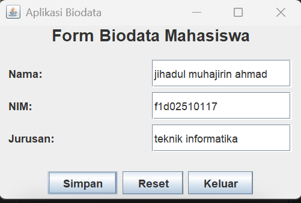
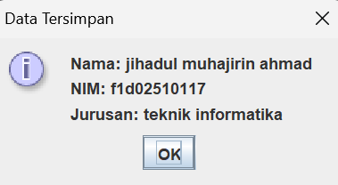

# Aplikasi Biodata Mahasiswa (Java Swing)

Aplikasi GUI sederhana berbasis **Java Swing** untuk mengisi biodata mahasiswa. Dibuat sebagai tugas mata kuliah **Pemrograman Berorientasi Objek (PBO) Pertemuan 10**.

## Tampilan Aplikasi

### Form Utama


### Dialog Data Tersimpan


> Taruh foto di folder `screenshot/` dengan nama `form.png` dan `dialog.png`.

## Fitur

- Input **Nama**, **NIM**, dan **Jurusan**
- Tombol **Simpan**: menampilkan data dalam dialog (dengan validasi kolom tidak boleh kosong)
- Tombol **Reset**: mengosongkan semua kolom
- Tombol **Keluar**: keluar dari aplikasi dengan dialog konfirmasi

## Konsep yang Digunakan

| Konsep | Komponen |
|---|---|
| Top-level container | `JFrame`, `JOptionPane` |
| Intermediate container | `JPanel` |
| Atomic component | `JLabel`, `JTextField`, `JButton` |
| Layout manager | `BorderLayout`, `GridLayout`, `FlowLayout` |
| Event handling | `ActionListener` (lambda expression) |

## Struktur Folder

```
gui/
├── gui.java
├── README.md
└── screenshot/
    ├── form.png
    └── dialog.png
```

## Persyaratan

- Java JDK 8 atau lebih baru
- Cek versi dengan perintah: `java -version`

## Cara Menjalankan

1. Clone repository ini:
   ```
   git clone https://github.com/username/nama-repository.git
   ```
2. Masuk ke folder project:
   ```
   cd nama-repository
   ```
3. Compile dan jalankan:
   ```
   javac gui.java
   java gui
   ```

> Nama file harus sama dengan nama class publik di dalamnya.

## Penulis

- **Nama**: (isi nama kamu)
- **NIM**: (isi NIM kamu)
- **Kampus**: (isi nama kampus)
